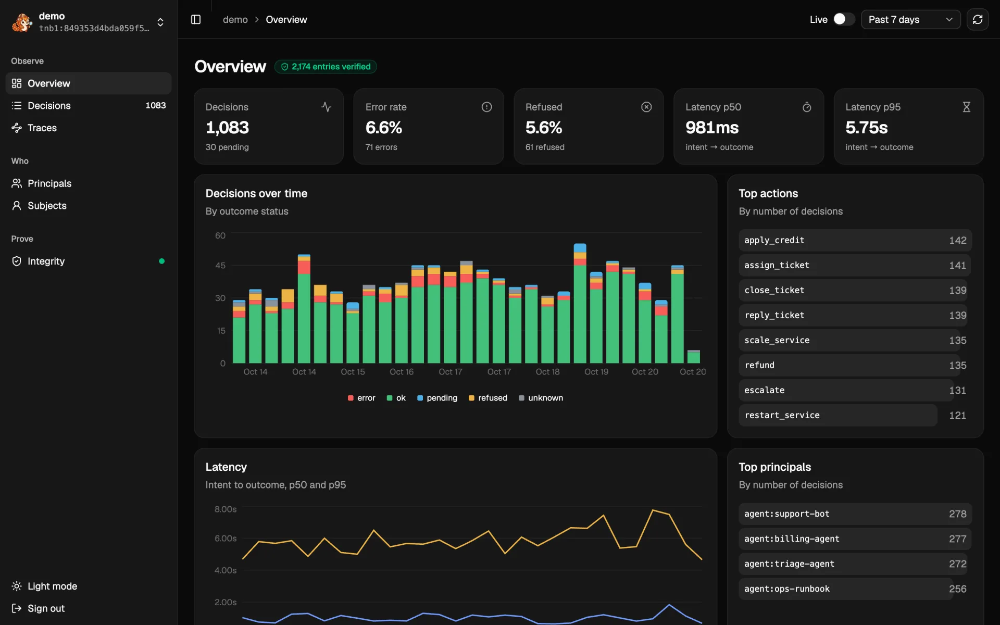
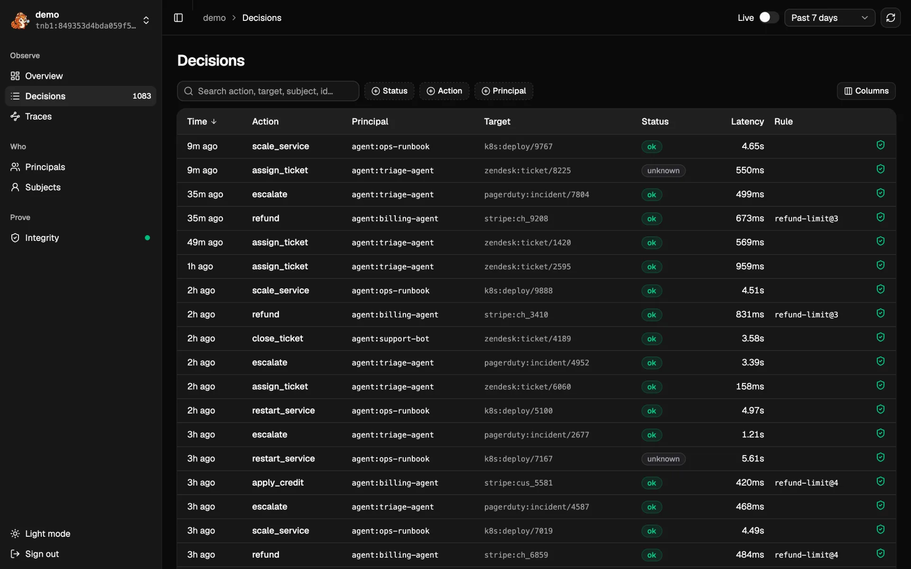
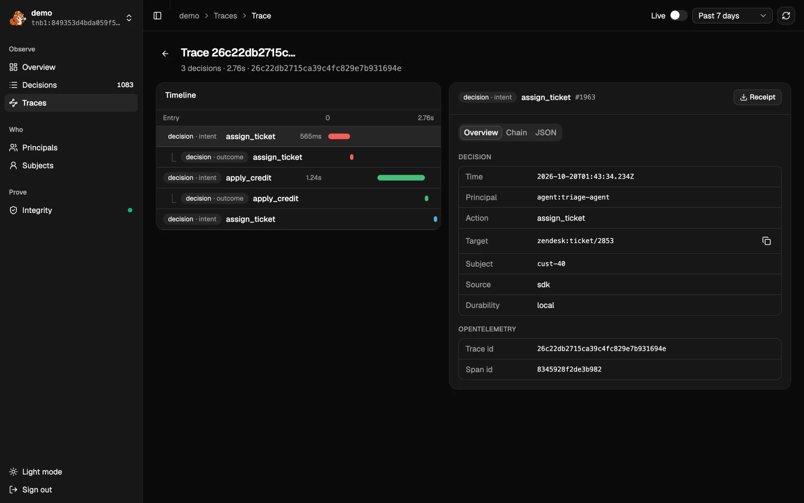

`tenbrid` serves **Tenbri UI** at its root: a read-only web UI over the same REST API your agents
write to. It shows what your agents decided, how it went and whether the record still verifies,
without anyone running a command.



<Callout title="Next release">
Tenbri UI ships with the release after `0.1.0-beta.3`. Until then, build `tenbrid` from `main`:
`cargo build -p tenbri-server --release` in a checkout of
[tenbri/tenbri](https://github.com/tenbri/tenbri).
</Callout>

## Run it

Start `tenbrid` with at least one stream and one token, as in
[The tenbrid server](/docs/getting-started/install/#the-tenbrid-server):

```sh
tenbrid token                    # prints a token once, and its [[tokens]] entry
tenbrid --config tenbrid.toml
```

Open http://127.0.0.1:7070 and sign in with the stream's name from `tenbrid.toml` (or its `tnb1:`
id) and the bearer token. The token stays in that browser tab (`sessionStorage`) and is sent only
to `tenbrid`. A token sees the streams its `[[tokens]]` entry allows; add more streams from the
stream menu at the top of the sidebar.

The UI is read-only: it calls the query, entry, receipt, tail and verify endpoints, never a write.
To reach it from another machine, set `listen` (or `TENBRI_LISTEN`) and put `tenbrid` behind TLS,
as for any client.

## Pages

Every page reads the time range picked at the top (past hour to all time). **Live** follows new
entries as they are written.

| Page | What it shows |
| --- | --- |
| Overview | Decisions by outcome status over time, error and refusal rates, intent to outcome latency (p50, p95), top actions and principals |
| Decisions | One row per decision: the intent joined with its outcome and approval. Search, filter by status, action and principal, sort, pick columns. Filters are in the URL, so a link shares the view |
| Decision | The approval, intent and outcome on a timeline, and each entry's fields, chain links and raw JSON. **Receipt** downloads a [receipt](/docs/concepts/integrity/) for the entry |
| Traces | Decisions grouped by their OpenTelemetry trace; each opens as one timeline |
| Principals | Per agent or person: decisions, error rate, refusals, p95 latency, top action |
| Subjects | Per subject: the decisions about them, the data [erasure](/docs/concepts/privacy/) works on |
| Integrity | Whether the whole stream verifies against its pinned key, the head, the latest checkpoint and the key events |





## Limits

- The UI reads the selected range into the browser, at most 20,000 entries, and computes the
  charts there. Pick a shorter range for busier streams.
- Live follows every new entry, whatever the filters.
- A verified badge comes from `GET /v1/streams/{stream}/verify`, which reads the whole stream from
  storage. For evidence you hand over, use a receipt or `tenbri verify` with your own pin
  ([Verify as an auditor](/docs/examples/verify-as-an-auditor/)).
