Agents now refund customers, deploy code and disable accounts. When one gets it wrong, you need more
than a log line: you need proof of what it decided, what it saw and who signed off. That's Tenbri.

Why a pangolin? Its scales overlap like a hash chain: you can't lift one without disturbing the rest.

More soon. Star the [repo](https://github.com/tenbri/tenbri) to follow along.
